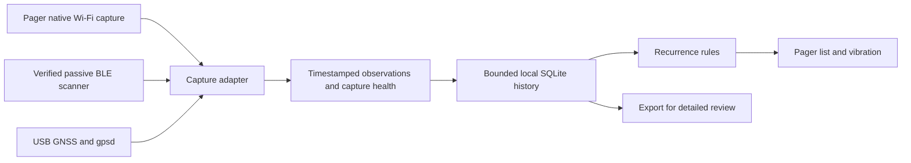

# Chasing Your Tail capability and product assessment

Assessment date: November 3, 2026. Priority: portable awareness of recurring nearby radios.

**CYT is worth continuing as a tool that records and explains recurring wireless observations along your route. The present NG implementation is not a dependable detector of people following you, and recovering a modern phone's remembered networks is not a viable primary product promise.** A small, offline Pager with GPS is technically plausible. Its value would be understandable evidence, reliable collection, and restrained alerts. Hardware cannot restore information that a phone does not transmit.

There is an especially useful development: Kismet's current stable release is **2026-10-R1**, and the tagged source contains optional Wi-Fi randomized-address linking. This gives CYT an upstream experiment to evaluate rather than a reason to develop another identity-recovery engine. Keep inferred relationships visibly separate from exact-address observations. [Kismet downloads](https://www.kismetwireless.net/download/), [tagged configuration](https://github.com/kismetwireless/kismet/blob/kismet-2026-10-R1/conf/kismet_80211.conf).

## Decision and product promise

Build around this statement:

> CYT records nearby wireless activity and shows which advertised identifiers recur as you move, with the observation times, your locations, and the limits of the evidence.

An appropriate alert is “This Wi-Fi identifier appeared at three separated points on this route.” The observation could belong to your own equipment, a companion, another passenger, a vehicle hotspot, a fixed transmitter with a long range, or a copied address. Determining a person's identity or intent requires additional evidence.

The investment decisions are:

| Direction | Recommendation | Reason |
| --- | --- | --- |
| Exact-address recurrence with a timestamped route | Proceed to a measured prototype | Useful even with intermittent visibility; explanations are auditable |
| BLE advertisements alongside Wi-Fi observations | Proceed as a separate sensor input | Adds observable radios; does not eliminate address rotation |
| Self-contained Pager plus GPS | Proceed to a hardware feasibility test | Suitable interface and existing capture environment; limited resources |
| Universal modern-phone tracking | Do not promise | Privacy, radio silence, and capture gaps prevent dependable continuity |
| WiGLE lookup as a person's origin or home address | Retire that claim | An SSID is not unique, association history, or proof of residence |
| PFWS incident recorder | Possible later mode | Can preserve observed traffic; cannot guarantee a suspect emitted it |
| Preconfigured commercial hardware | Pilot after hardware and licensing gates | Supply, support burden, firmware behavior, and false alerts remain material |

The strongest public contribution would be an honest, reproducible study of what remains observable, accompanied by usable software. A prominent false identification would be worse for CYT's reputation than admitting uncertainty.

## What issue 36 gets right and what it overstates

The [issue](https://github.com/ArgeliusLabs/Chasing-Your-Tail-NG/issues/36) describes two different losses: probes may contain no network name, and their transmitter addresses may change. They affect different capabilities.

An empty-SSID probe is still a transmitted frame. A receiver on the right channel can observe its time, advertised address, and available radio metadata. It cannot recover a remembered network name from an empty field. A phone that is only listening, or is not emitting anything your receiver can hear, supplies no such observation.

Apple documents randomized unassociated scan addresses and, on supported devices, sequence-number randomization when scan addresses change. It also describes further frame fields being randomized to reduce fingerprinting. This makes sequence continuity an unreliable general rescue strategy. [Apple platform security](https://support.apple.com/guide/security/privacy-features-connecting-wireless-networks-secb9cb3140c/web).

The Android version in the quoted explanation is too broad. AOSP documents scan MAC randomization from Android 8, an optional connection setting in Android 9, and default connection randomization from Android 10. OEM implementations and operating state matter; an Android version label alone is not a detection specification. [AOSP implementation](https://source.android.com/docs/core/connect/wifi-mac-randomization).

Scanning and association must also be distinguished. Apple's current settings include per-network fixed and rotating private addresses. AOSP likewise describes persistent and non-persistent connection randomization. An associated client may therefore have useful short-term address continuity without exposing its factory MAC or providing a universal identity across networks. [Apple private addresses](https://support.apple.com/en-us/102509), [AOSP behavior](https://source.android.com/docs/core/connect/wifi-mac-randomization-behavior).

Directed probes remain an opportunistic input, including behavior associated with hidden networks, rather than a feature every nearby phone provides. Even a named probe establishes only that a frame containing that name was observed. It does not establish that the sender previously joined that network. Apple explicitly identifies a privacy risk with hidden networks. [Apple router guidance](https://support.apple.com/en-us/102766).

**An important code correction:** NG does not require a named probe for all MAC tracking. `process_current_activity()` invokes `_process_mac_tracking()` independently of its probe-name processing. Empty probes disappear from the named-probe path, while device records can remain available to the MAC path. Issue 36 therefore undermines the remembered-SSID use case much more directly than it eliminates every CYT function.

## Signals worth retaining or adding

The usefulness judgments below are engineering recommendations, not measured CYT detection rates.

| Signal | Useful output | Identity and coverage limit | Priority |
| --- | --- | --- | --- |
| Wi-Fi probe requests, including empty SSIDs | Time-bounded presence and recurrence of the observed address | Address changes split observations; phones may not probe during a pass | First release |
| Beacons from APs and portable hotspots | Recurring advertised BSSIDs along a route; environmental context | Fixed APs, virtual BSSIDs, copied addresses, and changing hotspot settings need care | First release |
| Transmitter headers of associated-client traffic | Recurrence while an address remains in use | Correct band/channel and frame parsing required; no need to decrypt payloads | First release if capture supports it |
| BLE advertisements | Nearby radios, short-term recurrence, recognized advertised service categories | Private addresses and payloads rotate; same vendor/service is not same device | Early extension |
| Named probes | Additional observed metadata | Sparse on many modern devices; shared names cannot establish identity | Optional detail |
| Upstream alias links | An explicitly tentative relationship between address records | Can mislink identical models or miss real rotations; preserve originals | Experimental view |
| Recognized tracker broadcasts | A dedicated tracker-category view with evidence | A tracker nearby may be legitimate; ordinary Apple BLE traffic is not automatically an AirTag | Separate extension |
| Valid Open Drone ID messages | Nearby Remote ID transmissions and their reported fields | Only compatible emitting aircraft; broadcast claims may be spoofed | Optional later extension |
| RSSI trends | Supporting evidence and a way to inspect signal changes | Not reliable meters, direction, room, or ownership from one receiver | Detail view only |
| Observer GPS | Where the CYT unit was when it heard a transmission | Does not locate the remote transmitter | Core requirement for route claims |

Bluetooth offers more opportunities to observe activity, but it has its own privacy mechanism. Bluetooth LE Privacy rotates advertised addresses; resolving a resolvable private address uses an Identity Resolution Key from a trusted relationship. A generic scanner does not have every stranger's key. [Bluetooth SIG privacy explanation](https://www.bluetooth.com/blog/bluetooth-technology-protecting-your-privacy/).

For recognized trackers, complement the phone platforms rather than promising to replace them. Android already provides alerts for supported unknown trackers moving with the user and distinguishes this from a tracker merely being nearby. CYT can add inspection and local export, but needs protocol-specific validation. [Android unknown tracker documentation](https://support.google.com/android/answer/13658562).

Kismet now documents Open Drone ID decoding from compatible Wi-Fi and BLE captures. Decode the actual protocol if this feature is added; an SSID prefix or manufacturer OUI is only a category hint. Kismet also states that it records broadcast identity/location claims without verifying authentication. [Kismet Remote ID](https://www.kismetwireless.net/docs/readme/datasources/drone-opendroneid/).

Defer generic hidden-camera detection, cellular identity collection, tire-pressure radios, and broad SDR support. They introduce different receivers, protocols, claims, and test programs. The Pager's built-in radio set is not a general-purpose receiver for every wireless device. A device with a camera or microphone is not evidence that either is being used to record the user.

## Whether fingerprinting can rescue continuity

Some research and implementations can associate subsets of randomized observations. That is different from reliable identification of every modern phone in a crowd.

Kismet's current documentation describes optional Wi-Fi and BLE alias relationships, disabled by default. Addresses remain separate records, with relationship metadata. Kismet explicitly warns that linking can be wrong or missed and that relationships do not persist between runs. This is the right conceptual separation for CYT. The Wi-Fi option was verified in the `2026-10-R1` tag; behavior documented as **after** that release must be tested on its actual build. [Kismet randomized addresses](https://www.kismetwireless.net/docs/readme/configuring/randomized_macs/).

A June 2026 preprint reports up to 89.6% clustering accuracy on 22 devices using hardware features and simulated signal measurements. That result is not an 89.6% success rate for one moving Pager in a real crowd. It is a reason to run a controlled experiment, including identical phone models and held-out routes. A separate 2024 paper demonstrates how generic probe requests could reduce distinguishability further. Neither justifies an unconditional product guarantee. [Puig et al.](https://arxiv.org/abs/2606.25788), [Ansohn McDougall et al.](https://arxiv.org/abs/2405.09230).

Keep any research on aliasing behind an explicit experimental setting, with the method and original addresses visible. Evaluate false merges separately from missed links. Never increase a threat label just because a phone uses a normal privacy feature. Do not merge Wi-Fi and BLE identities because their RSSI or timestamps look similar. People in the same bus or room produce those coincidences naturally.

Active reconnection tricks would change the premise of a passive awareness product. They also do not provide the missing general identity guarantee. They are outside this design.

## Code audit of the public NG repository

Audited baseline: `89c88be994cfc4ea2f7e151b7c5f0f4ac9d9ca5a`, committed July 23, 2025. There are 4,907 lines across 16 top-level Python files. The source snapshot has no automated test suite. The desktop GUI, reporting, collection queries, credential migration, and detection assumptions are tightly coupled.

The findings below distinguish executable reproductions from source inspection. The synthetic reproductions make no WiGLE calls and use no captured personal data. Run `python -B research/reproduce_ng_findings.py`; the saved result is [ng-reproduction-results.json](../research/ng-reproduction-results.json).

| Priority | Finding and evidence | Consequence | Change required |
| --- | --- | --- | --- |
| Critical | `surveillance_detector.py:149,223,241,535,755` assigns 0.95 accuracy, converts a heuristic into confidence, and prints a fixed confidence interval and false-positive rate. Reproduced 95% with no observations. | Reports imply validation that the implementation does not compute. | Remove these claims; report observed counts and measured benchmark results only. |
| Critical | `surveillance_analyzer.py:115,149,172,375` uses device average coordinates, discards historical GPS times, and passes a common `Location_1`. `gps_tracker.py:51` stamps import time. Reproduced two historical observations assigned to one location. | Maps and multi-location conclusions can misrepresent the evidence. | Use actual observer fixes matched to event time, including fix age and accuracy. |
| High | `surveillance_detector.py:833` loads one `devices` summary row per device per database. Re-importing the same row adds another appearance. | A long single capture may yield only one appearance; split/reloaded files can inflate counts. | Store a real observation history with source identity and duplicate handling. |
| High | `secure_database.py:127` reads only the last probed SSID and labels it with device `last_time`. Reproduced a probe recorded at 100 reported at 1000. | Old named probes can be presented as new; other probe records are lost. | Preserve probe-specific times, or label the field as historical summary metadata. |
| High | `surveillance_detector.py:98` scores three appearances at one place over one hour as 1.0. Reproduced using an AP. | Stationary background radios can receive the maximum score. | Separate recurrence from route evidence and from any interpretation of intent. |
| High | `cyt_gui.py:20,525,562,653` and `surveillance_analyzer.py:36` force test mode; `secure_credentials.py:68` supplies a fixed fallback password. | Noninteractive use can silently select a known encryption password or fail to unlock existing credentials. | Remove implicit test mode; keep optional online enrichment out of startup. |
| High | `config.json` selects `.py` ignore files while the shipped data and GUI writer use `.json`. Reproduced both configured paths missing. | Own-device filtering can appear configured while loading nothing. | One JSON format, one authoritative path resolver, visible load errors. |
| Medium | `secure_main_logic.py:191` compares incoming MAC text with uppercase sets without first normalizing it. Reproduced missed lowercase match. | Equivalent address strings can fail recurrence checks. | Normalize at the input boundary. |
| Medium | `chasing_your_tail.py:71,134` selects one database only at startup; its outer error `continue` bypasses sleep. | Rotation can leave monitoring on an old file; connection failures can cause a hot retry loop. | Track source lifecycle and use bounded retry/backoff with health status. |
| Medium | `probe_analyzer.py:27,232` expects inconsistent date formats. The main log does not timestamp each probe; fallback is the file's start time and splits the entire path on underscores. | Incident windows can be wrong, and parsing may fail. | Structured UTC event records; never reconstruct event time from filenames. |
| Medium | `cyt_gui.py:307,319` updates Tkinter widgets from background threads. | Intermittent UI failures are possible. | A main-thread UI queue, or a small separate UI consuming core state. |
| Medium | `input_validation.py:37` rejects legitimate SSIDs such as `Alice's WiFi`. | Valid names cannot be added to ignore lists. | Treat SSIDs as data; escape at output boundaries and bind SQL values. |
| Medium | `surveillance_analyzer.py:254` requests `high_threat_devices`, while returned results contain `high_persistence_devices`. | The demo path can fail after analysis. | A shared typed result model and an end-to-end demo check. |
| Medium | Shell scripts hard-code `/home/matt/Desktop/cytng`, `wlan1`, long sleeps, and a desktop/X session. README advertises Python 3.6 despite newer language/library requirements. | A new installation is not a portable appliance. | Explicit supported runtime and platform-specific service packaging. |

These are not all effects of MAC randomization. Correcting phone assumptions without correcting the event model would still leave misleading results.

The existing four-window live monitor can retain samples over time, but its startup database queries partition each device by its latest timestamp. They cannot reconstruct all earlier sightings from a mutable device summary. Polling the same summary also does not establish a new packet arrival. The replacement must preserve this distinction throughout reports and tests.

Parameterized SQL and removal of `exec()` are useful changes worth retaining. The broad “all vulnerabilities eliminated” messages are not a substitute for correctness or a security assessment. Credential encryption and string sanitization do not repair an inaccurate observation history.

Existing contributions should be reviewed before duplicating them. [PR 10](https://github.com/ArgeliusLabs/Chasing-Your-Tail-NG/pull/10) addresses ignore filenames. [PR 23](https://github.com/ArgeliusLabs/Chasing-Your-Tail-NG/pull/23) proposes tooling and an earlier review. [PR 34](https://github.com/ArgeliusLabs/Chasing-Your-Tail-NG/pull/34) adds Pi deployment infrastructure. Those proposals do not establish detection accuracy or resolve the central observation model merely by being present.

## A self-contained Pager design

**Yes: the Pager can plausibly be the whole carried unit, with an attached GNSS mod, rather than a screen for a separate Raspberry Pi.** The GPS is an accessory, so the finished dimensions and pocket ergonomics must include it.

Hak5 specifies a 580 MHz MIPS processor, 256 MB RAM, 4 GB eMMC, a 480×222 display, 2000 mAh battery, USB host expansion, vibration, and Wi-Fi coverage across 2.4/5/6 GHz plus Bluetooth. That is enough reason to test a small collector and recurrence core; it is not evidence that the current Tkinter/reporting stack will run well there. [Pager specifications](https://hak5.org/products/pager).

Use these components:



The device should open into a short session flow: start route, check capture/GPS status, review recurring identifiers, mark known equipment, and stop/export. The first screen should show capture age, current bands, GPS condition, battery, and the number of recurring identifiers. A detail view should show the actual observations behind each alert. Use a vibration for a new recurrence event, with a cooldown, rather than continuously escalating on packet volume.

A reasonable screen concept is:

```text
CYT   ROUTE 18:42    GPS OK    76%
Wi-Fi fresh   BLE fresh   2/5/6G

2 identifiers recurring on route
Wi-Fi  ...:8A   3 places   14 min
BLE    ...:2F   1 place     6 min

A Details       B Mark / Stop
```

This is a proposed UI, not a screenshot or a claim of Pager deployment.

Native Recon already collects environmental data and supports persistent recon logging. However, native optimized PCAP logging trims some content. Before using it as the sole input, compare the frames and metadata retained with a reference capture on each band. Do not assume a command called `WIFI_PCAP_START` provides every desired frame from every radio. [Recon](https://documentation.hak5.org/wifi-pineapple-pager/recon), [PCAP command](https://documentation.hak5.org/wifi-pineapple-pager/wifi-pineapple-commands/wifi_pcap).

Python is a practical first prototype language if the installed runtime and resource measurements support it. Use the standard library where possible; avoid pandas, large ML frameworks, and continuous rich report generation on this target. Hak5 documents limited root-overlay space and recommends installing large packages to eMMC. It also warns against bulk-upgrading system packages. Ship a tested firmware/package matrix and a recovery path. [External packages](https://documentation.hak5.org/wifi-pineapple-pager/external-packages).

The Glytch GPS mod uses an LC86-series receiver with model-dependent serial settings and integrates through the Pager GPS setup. It enables location-aware logging. GPS may be unavailable indoors and may take time to acquire a fix; show stale/no-fix states and do not turn IP geolocation into route-quality GPS. [Mod documentation](https://github.com/glytchtech/Pager-Mod-Docs/blob/main/GPS/README.md), [Hak5 GPS expectations](https://documentation.hak5.org/wifi-pineapple-pager/gps).

Tri-band support is not continuous simultaneous coverage of every channel. Channel hopping trades completeness on one channel against coverage of more channels. Sparse phone bursts can fall in the gaps. Display collection health, and evaluate coverage under the actual firmware/radio configuration. [Kismet channel hopping](https://www.kismetwireless.net/docs/readme/datasources/channelhop/).

A passive collection mode must also account for the appliance's management AP, client Wi-Fi connections, and Bluetooth scanning behavior. Passive BLE scanning receives advertisements without sending scan requests; active scanning can transmit requests. Verify the actual mode rather than trusting the name of a wrapper. [Bluetooth LE primer](https://www.bluetooth.com/bluetooth-le-primer/).

**Battery life, usable BLE modes, sustained event rate, storage growth, and alerts with the screen off remain hardware measurements.** No all-day runtime claim follows from a 2000 mAh specification. Start with a four-hour pilot acceptance target and measure the full GPS-plus-radio workload. Use an external power pack if the chosen session length requires it.

## Existing Pager implementations

Two public ports already exist, so a new Pager port alone would not be novel. Their hardware experiments are useful; their claims require independent testing.

| Repository and reviewed revision | Useful material | Concerns found in source review | Recommendation |
| --- | --- | --- | --- |
| [pineapple-pager-projects/pineapple_pager_cyt](https://github.com/pineapple-pager-projects/pineapple_pager_cyt), `b898d77` | Python collector/UI separation; explicit passive BLE command; local sightings; GPS plumbing | Shared-SSID clustering, automatic cross-protocol score propagation, and strong threat labels. Stationary duration/frequency/RSSI can dominate. Integer GPS cells can change at boundaries. No root license found in checkout. | Reference hardware lessons; obtain explicit reuse rights before copying its original code. Replace scoring assumptions. |
| [tschakram/chasing-your-tail-pager](https://github.com/tschakram/chasing-your-tail-pager), `ec141b1` | Native payload commands, watch lists, export workflow | Its default BLE `hcitool lescan` command lacks `--passive`, and classic inquiry is also used. Its source comments describe capture-radio asymmetry. More enrichment and fingerprinting increases scope. Root license absent; attribution to MIT upstream alone is insufficient clarity for every added component. | Validate capture and transmission behavior; discuss licensing and interface reuse with its maintainer before distribution. |

These ports were inspected as source, not run on a Pager. In particular, the second port's capture-radio comments are a reason to test current firmware, not proof that every present Pager version behaves that way. Do not combine the two implementations wholesale: that would increase maintenance while retaining their weakest assumptions.

## A simpler codebase

Keep one data contract and one recurrence engine. Make Kismet and Pager capture adapters supply it, and make all user interfaces read the same results. SQLite is sufficient for local storage; a broker, microservices, or a large plugin framework would be unnecessary at this stage.

An observation needs a source/session identity, protocol, advertised address, source timestamp, event kind, optional named-SSID metadata, optional signal strength, and an optional observer fix with its own timestamp and accuracy. Capture-health events are separate: interface state, coverage/dwell information where available, drops, clock condition, GPS age, and storage availability.

Preserve three distinct concepts:

1. **Observation:** the collector heard a transmission or returned a documented summary update.
2. **Recurrence:** the same advertised identifier was observed again within the scope of this session.
3. **Hypothesis:** different identifiers may be related, or a repeated identifier may be moving with the observer.

Only the first two belong in the default prototype. A randomized address is not automatically useless: it can recur during its lifetime. A locally administered address is also not proof of rotation. When a new address appears, continuity is unknown unless a separately labeled hypothesis supplies evidence.

Kismet offers an eventbus for status and events. Use appropriate device updates or packet inputs for actual sightings; a “new device” event alone does not provide repeated appearances. For old `.kismet` files, inspect the schema version and use packet/data/GPS records when available. Import a `devices` row as a summary, not fabricated history. Kismet v11 distinguishes collector coordinates from positions reported by devices; older versions require extra care. [Eventbus](https://www.kismetwireless.net/docs/api/eventbus/), [KismetDB schema](https://www.kismetwireless.net/docs/dev/kismetdb/).

Move detailed HTML/KML reporting out of the capture loop. Generate it on demand from stored observations. Use structured JSON for interchange and plain output escaping rather than removing valid punctuation from observed names. Secrets should be needed only when an optional online feature is invoked.

The new [cyt_core](../cyt_core/__init__.py) is a small offline proof of this design: standard-library Python, normalized addresses, bounded analysis windows, duplicate rejection, empty-probe support, fix validation, and recurrence explanations. It deliberately does not join changed addresses or output threat probabilities. The [implementation notes](REFRACTOR_NOTES.md) state what is implemented and what remains before a live replacement.

## Selling a preconfigured version

Retail reference prices checked on November 3, 2026 through Hak5's public product data were **$300 Basic**, **$330 Pro**, and **$60 for the Glytch GPS mod**, in the US storefront. The mod reported unavailable. Base hardware plus that mod is therefore $360 or $390 before shipping, tax, setup, and support. These are reference retail costs, not wholesale quotes or a supply commitment. [Pager](https://shop.hak5.org/products/pager), [GPS mod](https://shop.hak5.org/products/glytch-gps-mod-for-pager), [saved price snapshot](../research/hardware-price-snapshot.json).

Three sales models avoid designing a circuit board:

| Model | Your work | Fulfillment and tradeoff |
| --- | --- | --- |
| CYT package plus setup/support | Software, tested installation, documentation, support | Customer buys hardware; least inventory exposure and easiest initial pilot |
| Preconfigured stock hardware | Procurement, provisioning, burn-in, labeling, packaging, returns | No electronics manufacturing, but you still operate a hardware business |
| Reseller or integrator bundle | Release specification, acceptance tests, training, support agreement | Partner procures, configures, tests, and ships; best fit for avoiding assembly/fulfillment work if a partner agrees |

Hak5 has an authorized reseller program. Its software license includes restrictions concerning distribution and transfer of proprietary software. Get written terms covering preinstallation, firmware delivery, trademarks, support responsibility, warranty, and reseller/integrator status before offering a commercial bundle. The license of your MIT application does not itself settle rights to redistribute a vendor firmware image. This is a supplier-contract requirement to resolve, not a conclusion that ordinary resale of a physical unit is categorically prohibited. [Reseller program](https://hak5.org/pages/authorized-resellers), [Hak5 software license](https://shop.hak5.org/pages/software-license-agreement).

Keep WiGLE outside the required product. Its published individual data license is non-commercial and disallows credential sharing. A paid service or bundle using its data needs appropriate commercial terms; asking each buyer for a personal key does not automatically resolve commercial-use restrictions. The recurrence function should work without Internet access or a WiGLE account. [WiGLE license](https://wigle.net/eula.html).

Illustrative unit economics, not a proposed supplier quote: selling a $360 retail-hardware bundle for $599 leaves $239 before other costs. If packaging/handling is $25, provisioning/testing $40, support/warranty reserve $60, and payment costs $18, contribution is **$96, about 16% of revenue**, before development, overhead, shipping subsidies, tax effects, and returns beyond the reserve. “Hardware plus a little extra” can be an unattractive business even without custom manufacturing. Partner discounts and proven support demand matter more than the enclosure.

For a sellable unit, provision unique credentials, avoid shared customer API keys, pin the tested firmware, record its release manifest, run a capture/GPS/button/vibration test, and document factory recovery. Set bounded retention and a clear local export/delete flow because route histories are sensitive customer data. Keep optional cloud uploads off by default.

## Validation and release decisions

The full [field validation plan](FIELD_VALIDATION_PLAN.md) separates radio visibility, address continuity, recurrence, and user alert performance. This separation prevents success at “heard a frame” from being advertised as success at “identified a follower.”

Start with a borrowed or purchased Pager/GPS and a Pi running a pinned Kismet version. Use consenting participants and known equipment as ground truth. Include current iPhones and Android phones, identical phone models, associated and unassociated states, locked screens, quiet radios, crowded routes, stationary APs, companions, transit, GPS loss, and clock changes. Replay the same captured observations through each candidate engine.

Do not publish an accuracy percentage based on synthetic tests. They verify software behavior, not RF sensitivity or human intent. For the portable product, the most decision-relevant quantities are nuisance alerts per route-hour, recurrence recall for radios that actually remain observable, delay to a useful alert, GPS-qualified coverage, and power/storage consumption.

The first release gate is an explainable recorder that never turns stale summaries into new events and never presents uncertain positions as a route. The second is acceptable alert behavior on control routes. The third is hardware endurance and reproducible installation. Only after those gates should a paid preconfigured pilot begin.

## Proposed implementation sequence

| Stage | Deliverable | Exit condition |
| --- | --- | --- |
| 1 | Evidence model, replay fixtures, replacement recurrence core, claim cleanup | Deterministic tests; old false-confidence language is absent from the new path |
| 2 | One Kismet adapter and local SQLite event store | Real observations survive restart, rotation, duplicates, and capture outages without fabricated history |
| 3 | Pager Wi-Fi/GPS adapter and minimal native screen | Reference captures confirm fields and coverage; end-to-end local operation on pinned firmware |
| 4 | Passive BLE and field evaluation | Transmission behavior verified; nuisance-alert and continuity results published by device/state |
| 5 | Optional alias/Remote ID experiments and fulfilled pilot | Separate evidence labels, known licensing, support ownership, and acceptance-tested hardware |

Stages 2 through 4 are likely several weeks of part-time engineering and field work, not a cosmetic weekend port; this is a planning estimate, not a delivery commitment. Limit early scope to portable recurrence. A fixed incident recorder can reuse the event store later with different retention and export requirements.

For PFWS specifically, an incident export should preserve timestamps, sensor identity, configuration, capture gaps, and original evidence references. A checksum can help detect changes to an export but does not establish that the recorded transmitter belonged to an intruder. Phone-torch use says nothing conclusive about Wi-Fi emissions. Never turn a WiGLE name match into a statement about a suspect's home or travel origin.

## Suggested reply to issue 36

This draft was subsequently [posted by the maintainer](https://github.com/ArgeliusLabs/Chasing-Your-Tail-NG/issues/36#issuecomment-6613936534) on November 3, 2026. Issue 36 is closed; its technical requirements are retained in [rewrite tracker 37](https://github.com/ArgeliusLabs/Chasing-Your-Tail-NG/issues/37). See the later [backlog review](https://github.com/ArgeliusLabs/Chasing-Your-Tail-NG/issues/37) for the other issue and PR dispositions.

> The behavior you observed is real, and the current documentation overstates what CYT can infer from modern phones. There are two separate limitations: a wildcard probe has no remembered SSID to look up, and changing MAC addresses break simple long-term continuity.
>
> Empty probes can still be observed as wireless activity. CYT's MAC path is separate from named-probe processing, so the absence of SSIDs does not remove every function. However, neither an observed MAC nor an SSID identifies a person, and a WiGLE match does not establish where that person lives or came from.
>
> The next version should retain timestamped observations, distinguish exact-address recurrence from tentative relationships, and explain capture and GPS gaps. Kismet now has optional randomized-address linking, but it is explicitly a best guess and needs testing; it is not a universal workaround.
>
> For your incident-recorder use case, the defensible result is a record of wireless activity observed during a window, with its limitations. It cannot guarantee that a phone was transmitting or that a recorded address belonged to the intruder. There are also timestamp/history issues in NG that need fixing before treating its current reports as reliable evidence.

## Scope and reproducibility

This assessment covers the public NG source, two public Pager ports, current primary-source platform/hardware documentation, and synthetic execution of the identified code paths. No radio, phone, Kismet server, or Pager hardware was connected. No live packet capture, hardware benchmark, vendor agreement, or field detection study was performed.

The original NG scripts remain unchanged so that the audit reproductions still target the reviewed baseline. New code is an explicitly experimental offline core; it is not a completed live replacement. The original assessment made no issue comment, message to a vendor, deployment, or purchase. The subsequent authorized [backlog review](https://github.com/ArgeliusLabs/Chasing-Your-Tail-NG/issues/37) posted contributor responses and closed selected issues/PRs; it did not merge or publish application code.
